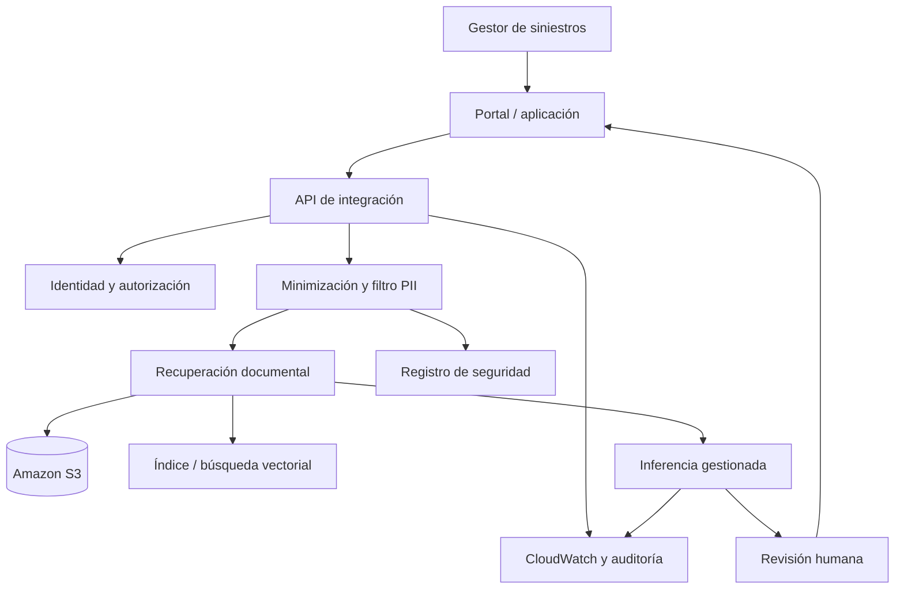

# AWS AI Architecture Modeler

Aplicación Streamlit que transforma parámetros de un escenario empresarial en una propuesta lógica de arquitectura AWS para una solución de IA documental. El escenario inicial representa una aseguradora que procesa documentación de siniestros.

> **Estado:** prototipo de recomendación académica/portfolio. No despliega recursos, no accede a una cuenta AWS y no constituye una arquitectura validada ni una cotización.

## Problema

Diseñar una solución de IA en cloud exige equilibrar volumen, latencia, concurrencia, privacidad, disponibilidad, recuperación, coste y nivel de control operativo. El modelador hace visibles esos factores y explica las decisiones sugeridas por sus reglas.

## Funcionalidades

- Recomendaciones por capas: datos, integración, inferencia, aplicación, seguridad y observabilidad.
- Adaptación de la clasificación documental según sector, volumen y presencia de PII.
- Comparación entre inferencia gestionada y una alternativa con mayor control técnico.
- Matriz de riesgos, mitigaciones, responsables y acciones inmediatas.
- Objetivos orientativos de latencia, disponibilidad, RTO y RPO.
- Reglas de recomendación separadas de la interfaz en `recommendations.py`.

## Arquitectura lógica de referencia



El diagrama expresa una arquitectura conceptual. La elección concreta de servicios, integración, región, cifrado, red y almacenamiento debe validarse en un diseño técnico detallado.

## Caso base

| Parámetro | Valor inicial |
|---|---:|
| Sector | Asegurador |
| Documentos diarios | 18.000 |
| Usuarios simultáneos | 220 |
| Latencia objetivo | 4 s |
| Datos personales (PII) | Sí |
| Presupuesto | Medio |
| Variabilidad de demanda | Media |
| Estrategia | Gestionado |
| Disponibilidad objetivo | Alta |
| RTO / RPO propuestos | 4 h / 1 h |

Los valores son entradas de ejemplo, no mediciones de una instalación real.

## Ejecución

```bash
python -m venv .venv
# Windows
.venv\Scripts\activate
# macOS/Linux
source .venv/bin/activate
pip install -r requirements.txt
streamlit run app.py
```

## Pruebas

```bash
python -m unittest discover -s tests -v
```

Las pruebas cubren sector, volumen, PII, presupuesto, estrategia de inferencia, concurrencia, latencia, variabilidad y objetivos de recuperación. GitHub Actions ejecuta la validación automáticamente.

## Criterios de arquitectura

- Aplicar minimización de datos y controles de acceso antes de enviar información a un modelo.
- Cifrar datos en tránsito y reposo y registrar las operaciones relevantes.
- Introducir revisión humana para decisiones sensibles o respuestas de baja confianza.
- Medir latencia p95, disponibilidad, tasa de escalado, coste y calidad.
- Definir RTO/RPO con negocio y validarlos mediante ejercicios de recuperación.
- Evaluar servicios con coste variable según alcance y necesidad; no asumir que una opción gestionada es siempre más barata.

## Limitaciones y trabajo futuro

- No calcula precios reales. La estimación requiere región, almacenamiento, peticiones, tokens, retención y patrón de uso, contrastados con AWS Pricing Calculator.
- Las reglas son heurísticas explícitas, no un motor de arquitectura oficial de AWS.
- Los objetivos SLO, RTO y RPO son propuestas iniciales que requieren aprobación.
- No hay despliegue IaC, configuración de IAM, VPC, KMS, políticas ni conectividad real.
- Próximas mejoras: exportación de arquitectura, estimador parametrizado de costes, validación de restricciones y pruebas de integración.

## Privacidad

No introduzcas datos personales reales, credenciales, claves API ni información confidencial.
